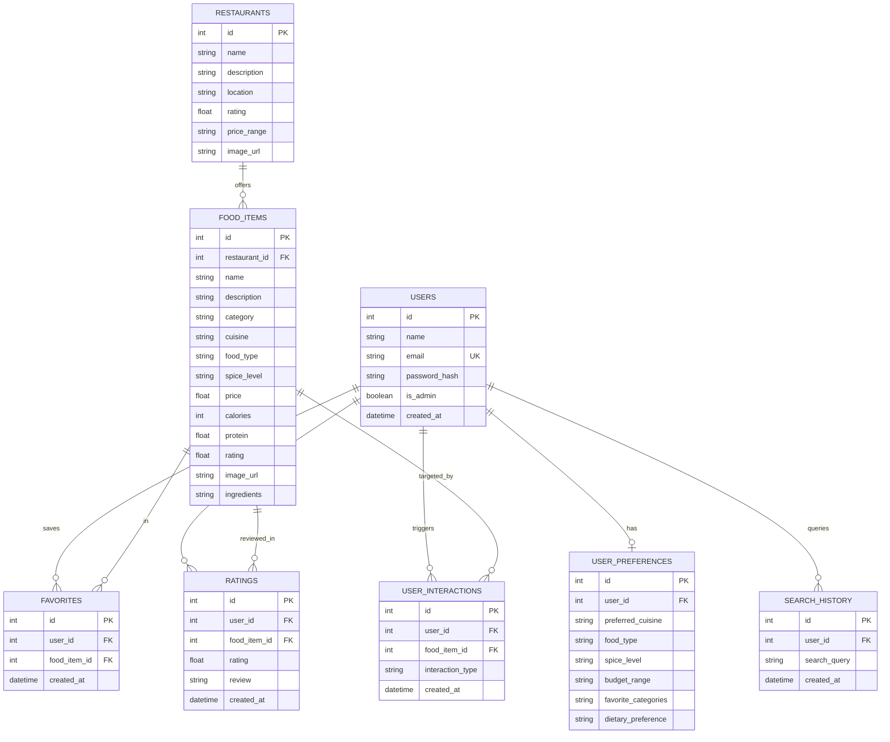

# FoodieAI – Smart Food Recommendation System

> **College IT Project Edition**  
> A full-stack, personalized food recommendation web application engineered with **FastAPI**, **React.js (Vite)**, **Tailwind CSS**, and **Neon PostgreSQL**.  
> Powered by a **transparent, rule-based / weighted scoring recommendation algorithm** in Python—100% explainable, deterministic, and free of black-box machine learning.

---

## Table of Contents
1. [Project Overview](#project-overview)
2. [Key Features](#key-features)
3. [Technology Stack](#technology-stack)
4. [Architecture & Data Flow](#architecture--data-flow)
5. [Recommendation Algorithm & Mathematical Formula](#recommendation-algorithm--mathematical-formula)
6. [Database Schema](#database-schema)
7. [Setup Instructions](#setup-instructions)
   - [Prerequisites](#prerequisites)
   - [Neon PostgreSQL Database Setup](#neon-postgresql-database-setup)
   - [Backend Setup (FastAPI)](#backend-setup-fastapi)
   - [Frontend Setup (React + Vite)](#frontend-setup-react--vite)
   - [Database Seeding](#database-seeding)
8. [Running the Application](#how-to-run)
9. [Demo Accounts](#demo-accounts)
10. [API Documentation](#api-documentation)
11. [College Viva & Oral Examination Notes](#college-viva-notes)
12. [Future Improvements](#future-improvements)

---

## Project Overview

Modern food delivery apps often use opaque machine learning models that can be difficult to explain or adapt for targeted user preferences. **FoodieAI** provides an intuitive, rule-based recommendation system tailored for personalized food discovery.

Instead of deep neural networks or complex collaborative filtering, FoodieAI evaluates dishes using a **weighted scoring algorithm** that considers:
- User preferred cuisines
- Dietary preferences (Vegetarian, Non-Vegetarian, Vegan, Eggitarian)
- Spice tolerance (Mild, Medium, Spicy)
- Target budget tiers
- Favorite food categories
- Community ratings
- Historical interactions (Saved favorites, reviews, and "Not Interested" marks)

Every single recommendation is accompanied by an **explainable match percentage (e.g., 96% Match)** and a natural human-readable reason explaining exactly why the dish was chosen.

---

## Key Features

- **Personalized Food Recommendations**:
  - *"Recommended For You"*: Highest scoring dishes tailored to user criteria.
  - *"Best Matches"*: Dishes achieving 80%+ compatibility.
  - *"Under Your Budget"*: Filtered recommendations strictly adhering to the user's spending limit.
  - *"Highly Rated"*: Best-reviewed dishes (★ 4.5+).
  - *"Try Something New"*: Suggestions from other cuisines to diversify user choices.
- **Explainable Match Reasons**:
  - Dynamically generated rule reasons such as: *"Matches your South Indian cuisine and vegetarian preferences, fits your budget of ₹300, and is highly rated."*
  - Expandable **Algorithm Breakdown** showing exact points awarded for each rule.
- **Interactive Taste Profile Onboarding**:
  - Multi-select wizard for cuisines, diet type, budget tiers, spice level, and dietary restrictions.
- **Food & Restaurant Discovery**:
  - Real-time search with multi-faceted filters (Cuisine, Diet, Price, Spice, Rating).
  - Search history tracking.
- **Food & Restaurant Details**:
  - High-resolution food photography, nutritional data (Calories, Protein), spice meters, key ingredients.
  - Restaurant menus categorized by course/type.
- **Engagement Tracking**:
  - One-click Favorites list.
  - Dish rating & reviews system.
  - "Not Interested" penalty interaction that actively reduces scores for dismissed items.
  - Simulated instant order flow.
- **My Taste Profile (Analytics)**:
  - Visual summary cards: Favorite Cuisine, Top Category, Budget, Spice level.
  - Dynamic affinity distribution progress bars.
- **Admin Control Dashboard**:
  - Key statistics: Total Users, Restaurants, Foods, Ratings, Favorites, Top Food, Top Cuisine.
  - Full CRUD management tables for dishes and restaurants.

---

## Technology Stack

### Frontend
- **Framework**: React 19 (Vite)
- **Routing**: React Router DOM (v7)
- **Styling**: Tailwind CSS (v4) with custom culinary palette
- **HTTP Client**: Axios with JWT interceptors
- **Icons**: Lucide React

### Backend
- **Framework**: FastAPI (Python 3.10+)
- **Server**: Uvicorn ASGI
- **ORM**: SQLAlchemy 2.0
- **Validation**: Pydantic v2
- **Authentication**: JWT (JSON Web Tokens) with `python-jose`
- **Security**: `bcrypt` password hashing

### Database
- **Primary**: Neon PostgreSQL (Serverless cloud Postgres)
- **Local Fallback**: SQLite (`foodieai.db`) for instant zero-configuration offline execution

---

## Architecture & Data Flow

```
+-------------------------------------------------------------------+
|                        React Frontend                             |
|  (Landing, Onboarding, Home, Search, Food Details, Profile, etc.) |
+---------------------------------+---------------------------------+
                                  | HTTP / JSON Requests (Axios)
                                  v
+-------------------------------------------------------------------+
|                        FastAPI Backend                            |
|                                                                   |
|   +-----------------------+     +-------------------------------+ |
|   |   JWT Authentication  |     |  Rule-Based Recommendation    | |
|   |     & Security        |     |         Engine                | |
|   +-----------------------+     +-------------------------------+ |
|                                                                   |
|   Routers:                                                        |
|   /api/auth  /api/preferences  /api/foods  /api/restaurants       |
|   /api/recommendations  /api/favorites  /api/ratings  /api/admin  |
+---------------------------------+---------------------------------+
                                  | SQLAlchemy ORM
                                  v
+-------------------------------------------------------------------+
|                      PostgreSQL / SQLite                          |
|  Users | UserPreferences | Restaurants | FoodItems | Favorites    |
|  Ratings | UserInteractions | SearchHistory                       |
+-------------------------------------------------------------------+
```

---

## Recommendation Algorithm & Mathematical Formula

### The Scoring Formula
The recommendation score for any dish $F$ with respect to user preferences $P$ is given by:

$$\text{Score}(F, P) = S_{\text{cuisine}} + S_{\text{type}} + S_{\text{category}} + S_{\text{spice}} + S_{\text{budget}} + S_{\text{rating}} + S_{\text{history}} + S_{\text{penalties}}$$

The raw score is clamped to the range **$[0, 100]$** and displayed as **Match Percentage**:

$$\text{Match Percentage} = \min(100, \max(0, \text{Score}))$$

### Scoring Rules Breakdown

| Rule Parameter | Condition | Points Awarded / Deducted |
| :--- | :--- | :--- |
| **Cuisine Match** | Dish cuisine matches user's preferred cuisines | **+30 Points** |
| **Food Type Match** | Exact match (e.g. Vegetarian == Vegetarian) | **+25 Points** |
| | Compatible (e.g. Non-Veg user eating Veg/Vegan dish) | **+20 Points** |
| | Strict Mismatch (Vegetarian user evaluating Non-Veg item) | **-20 Points** |
| **Favorite Category** | Dish belongs to user's favorite category (e.g. Dosa, Biryani) | **+20 Points** |
| **Spice Match** | Exact spice tolerance match | **+10 Points** |
| | Close spice level (e.g. Medium vs Mild) | **+5 Points** |
| **Budget Match** | Price falls inside selected range (e.g., ₹150–₹300) | **+10 Points** |
| | Price is well below target budget (economical choice) | **+8 Points** |
| **Budget Exceeded** | Dish price strictly exceeds selected budget limit | **-15 Points** |
| **Rating Score** | Dish average rating $\ge 4.5$ stars | **+5 Points** |
| | Dish average rating $\ge 4.0$ stars | **+3 Points** |
| **User History Boost**| User previously favorited items in this food category | **+10 Points** |
| | User previously rated items in this category 4★ or 5★ | **+5 Points** |
| | User previously rated items in this category 1★ or 2★ | **-10 Points** |
| **"Not Interested"** | User clicked "Not Interested" on this exact dish | **-35 Points** |
| | User clicked "Not Interested" on this food category | **-15 Points** |
| **Dietary Focus** | High Protein goal and dish protein $\ge 18\text{g}$ | **+5 Points** |
| | Low Calorie goal and dish calories $\le 350\text{ kcal}$ | **+5 Points** |

---

## Database Schema



---

## Setup Instructions

### Prerequisites
- **Python**: Version 3.10 or higher
- **Node.js**: Version 18 or higher (along with `npm`)
- **Git**

---

### Neon PostgreSQL Database Setup (Optional Cloud Mode)

1. Create a free PostgreSQL database on [Neon.tech](https://neon.tech).
2. Copy your connection string from the Neon dashboard:
   ```text
   postgresql://[user]:[password]@[neon-hostname]/[database]?sslmode=require
   ```
3. Paste it into `backend/.env`:
   ```env
   DATABASE_URL=postgresql://[user]:[password]@[neon-hostname]/[database]?sslmode=require
   ```
> **Note**: If `DATABASE_URL` is left empty, the application automatically creates and connects to a local SQLite database (`foodieai.db`).

---

### Backend Setup (FastAPI)

1. Navigate to the backend folder:
   ```bash
   cd backend
   ```

2. (Optional) Create and activate a Python virtual environment:
   ```bash
   python -m venv venv
   # On Windows:
   venv\Scripts\activate
   # On macOS/Linux:
   source venv/bin/activate
   ```

3. Install required Python packages:
   ```bash
   pip install -r requirements.txt
   ```

4. Create your `.env` configuration:
   ```bash
   # On Windows (cmd):
   copy .env.example .env
   # On Windows (powershell) or macOS/Linux:
   cp .env.example .env
   ```

5. Seed the database with 20 restaurants, 120 dishes, and sample accounts:
   ```bash
   python seed.py
   ```

6. Run the recommendation algorithm verification test:
   ```bash
   python test_recommendation.py
   ```

---

### Frontend Setup (React + Vite)

1. In a new terminal, navigate to the frontend directory:
   ```bash
   cd frontend
   ```

2. Install dependencies:
   ```bash
   npm install
   ```

3. (Optional) Configure `frontend/.env`:
   ```env
   VITE_API_URL=/api
   ```

---

## How to Run

### 1. Start the Backend Server
```bash
cd backend
python -m uvicorn app.main:app --reload --port 8000
```
- API Root: `http://127.0.0.1:8000`
- Interactive Swagger API Docs: `http://127.0.0.1:8000/docs`

### 2. Start the Frontend Development Server
```bash
cd frontend
npm run dev
```
- Web Application: `http://127.0.0.1:5173`

---

## Demo Accounts

The database comes pre-seeded with ready-to-use accounts for demonstration and grading:

| Role | Email | Password | Taste Profile Preset |
| :--- | :--- | :--- | :--- |
| **Student User** | `user@foodieai.com` | `password123` | South Indian, Vegetarian, Medium Spice, ₹150–₹300 |
| **Admin Officer** | `admin@foodieai.com` | `admin123` | Full administrative privileges & CRUD operations |

*(The login page also includes **One-Click Quick Login** buttons for instant demo access during viva presentations).*

---

## API Documentation

FastAPI automatically generates interactive OpenAPI documentation at `/docs`. Key endpoints include:

### Authentication
- `POST /api/auth/register` – Register a new user account.
- `POST /api/auth/login` – Authenticate user and receive JWT access token.
- `GET /api/auth/me` – Retrieve currently logged-in user profile.

### Preferences
- `GET /api/preferences` – Get user's taste criteria.
- `PUT /api/preferences` – Update taste criteria (recalculates recommendations).

### Recommendations
- `GET /api/recommendations` – Primary personalized recommendation feed.
- `GET /api/recommendations/best-match` – Dishes with $\ge 70\%$ match score.
- `GET /api/recommendations/popular` – Top community-rated dishes ($\ge 4.5\star$).
- `GET /api/recommendations/budget` – Dishes strictly under user's budget ceiling.
- `GET /api/recommendations/try-new` – High-rated specialties outside primary cuisine.

### Foods & Restaurants
- `GET /api/foods` – List foods with filtering by cuisine, category, price, rating.
- `GET /api/foods/{id}` – Get dish details with breakdown and similar items.
- `GET /api/restaurants` – List registered restaurants.
- `GET /api/restaurants/{id}` – Get restaurant details with categorized menu.

### User Actions
- `GET /api/favorites` – List saved favorites.
- `POST /api/favorites/{food_id}` – Save dish to favorites.
- `DELETE /api/favorites/{food_id}` – Remove dish from favorites.
- `POST /api/ratings` – Submit rating (1–5 stars) and review.
- `POST /api/interactions` – Record interaction (`view`, `not_interested`).
- `GET /api/search?q=...` – Search food catalog and record query in search history.
- `GET /api/profile/taste` – Retrieve visual taste analytics and affinity distributions.

### Admin Dashboard
- `GET /api/admin/dashboard` – Overall statistics and user list.
- `POST /api/admin/foods` – Add new dish.
- `PUT /api/admin/foods/{id}` – Edit dish details.
- `DELETE /api/admin/foods/{id}` – Delete dish.
- `POST /api/admin/restaurants` – Add new restaurant.
- `PUT /api/admin/restaurants/{id}` – Edit restaurant.
- `DELETE /api/admin/restaurants/{id}` – Delete restaurant.

---

## College Viva Notes

If asked during viva or project review:

1. **Why not use Deep Learning / Machine Learning?**
   - In cold-start scenarios with new users or changing menus, ML models require large training datasets and periodic re-training.
   - A weighted rule-based model is **100% explainable**: every student, examiner, or customer can trace exactly why a dish was recommended (e.g., *"Cuisine +30, Veg +25, Budget +10"*).
   - Low latency: computations run in linear time $\mathcal{O}(N)$ without high GPU memory overhead.

2. **How does user history influence future recommendations?**
   - If a user favorites dishes from a category (e.g., *Biryani*), that category receives a $+10$ boost.
   - If a user gives a 4★ or 5★ review, dishes in that category receive a $+5$ boost.
   - If a user clicks **"Not Interested"**, the item receives a $-35$ point penalty and its category receives a $-15$ point penalty, removing it from prominent view.

3. **How does the system prevent non-vegetarian food from being recommended to vegetarians?**
   - The engine checks food compatibility: if the user prefers *Vegetarian* and the item is *Non-Vegetarian*, it applies a $-20$ mismatch penalty and awards $0$ for dietary type, keeping it away from the recommendations.

---

## Future Improvements

- Integration with real payment gateways (Razorpay / Stripe) for live order processing.
- Multi-language localization for regional Indian languages (Hindi, Tamil, Telugu, Kannada).
- Push notifications for daily lunch and dinner suggestions.
- Location-based restaurant proximity filtering using GPS coordinates.
